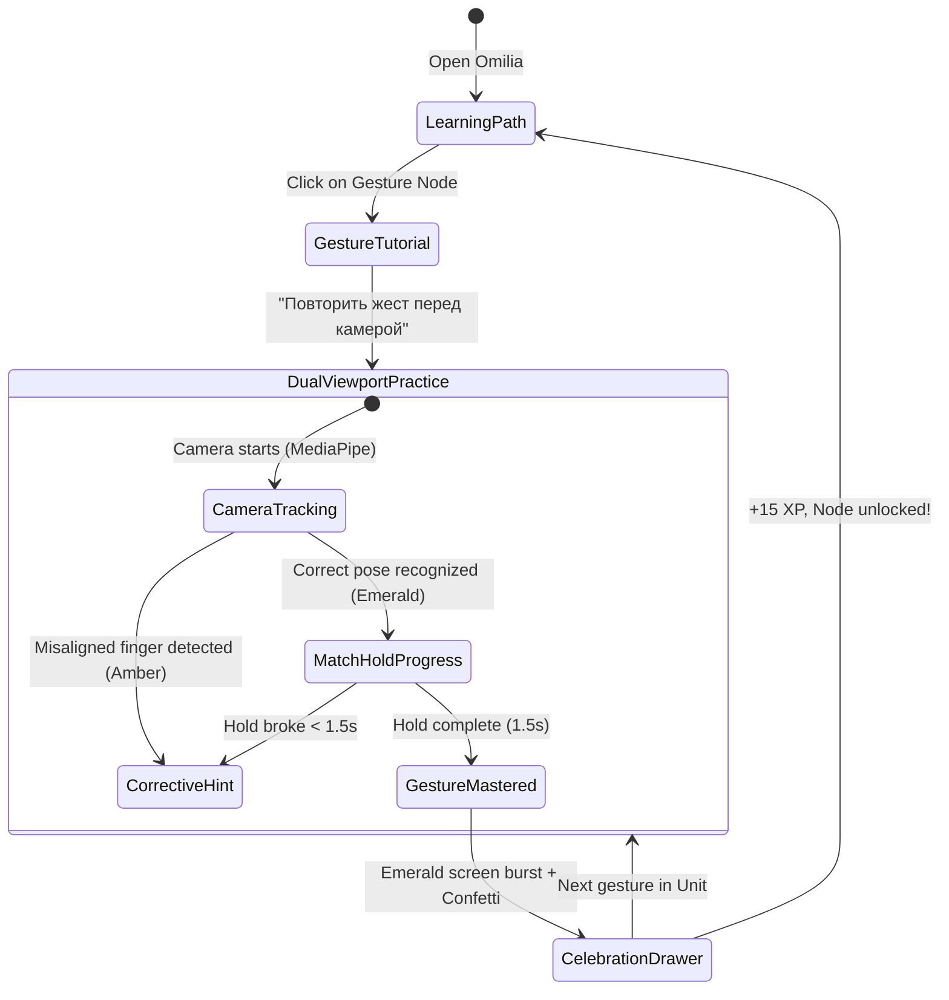

# Project Omiλia — UI/UX Design System & Experience Architecture Specification

> **Document Version:** 2.0.0 (Modern Education Platform Redesign)  
> **Status:** Approved for Implementation  
> **Target Audience:** `@stylist` (CSS Architecture), `@frontend` (HTML/JS Implementation), `@verifier` (QA & Test Verification)  
> **Inspirations:** Duolingo (Tactile gamification & learning path), Brilliant.org (Sleek dark mode & interactive first-principles), Lingvano & SignAll (Dual-viewport sign language camera HUD & sound-independent feedback), Khan Academy (Mastery progression).

---

## 1. Executive Summary & Design Vision

**Project Omiλia** is an AI-powered interactive Russian Sign Language (РЖЯ) learning platform that analyzes finger/hand landmarks in real-time in the user's browser (0ms ping via ONNX Runtime Web and MediaPipe).

### Core Problem Solved by Redesign
1. **Light/Harsh Theme Fatigue:** The previous light/white interface caused glare during webcam sessions in dim environments and provided suboptimal contrast for camera hand overlays.
2. **Flat / Monolithic Navigation:** The interface previously felt like a static dictionary instead of an engaging, bite-sized curriculum.
3. **Sound-Independent Accessibility:** Deaf and hard-of-hearing learners require vivid, high-impact visual reinforcement (tactile feedback, screen edge glows, particle celebrations, clear visual cues) without audio reliance.
4. **Camera Confidence & Guidance:** Real-time sign verification requires ergonomic camera framing, smooth hold-meter timers (400–1500ms), and contextual corrective hints rather than ambiguous error states.

### Design Theme: *Cyber-Atelier (Sleek Dark Glassmorphism)*
A clean, distraction-free obsidian/slate foundation with vibrant electric blue and emerald neon accents, frosted glass layers, tactile 3D interactive controls, and accessible typography.

---

## 2. Competitive UX Benchmark Insights

| Platform | Best-in-Class Feature | How Project Omilia Adopts It |
| :--- | :--- | :--- |
| **Duolingo** | Modular Learning Path ("The Path"), tactile 3D buttons, bottom celebration drawer, streak loss-aversion. | A structured 4-unit curriculum tree with nodes (Locked, In-Progress, Mastered), 3D tactile buttons (`border-bottom: 4px`), bottom celebratory slide-up drawer with XP counter. |
| **Brilliant.org** | Focused dark-slate canvas, clean typographic hierarchy, interactive verification loop. | Deep slate canvas (`#0B0F19`, `#131B2E`), subtle glow cards, high-contrast crisp text, instant interactive feedback. |
| **Lingvano** | Dual-viewport practice (side-by-side reference video + live camera mirror), multi-angle signing demos. | Dual-viewport modal: synchronous loop reference video on the left, live webcam with real-time MediaPipe skeletal overlay on the right. |
| **SignAll** | Color-coded skeleton feedback, circular confidence hold ring, distance/framing guidance. | Skeleton landmarks color-coded (Cyan: detected, Amber: corrective finger hint, Emerald: match), circular or smooth progress hold meter, posture guidance outline. |
| **Khan Academy**| Mastery levels (Familiar ➔ Proficient ➔ Mastered), clear unit progression. | 4-tier mastery badges per gesture and comprehensive stats dashboard in personal cabinet. |

---

## 3. Design System Tokens (CSS Variables)

`@stylist`: Replace existing `:root` variables in `style.css` with these standardized tokens.

```css
:root {
  /* ==================================================== */
  /* Surfaces & Canvas (Dark Slate / Glassmorphic)        */
  /* ==================================================== */
  --bg-primary: #0b0f19;          /* Deep space canvas */
  --bg-surface: #131b2e;          /* Main card & container background */
  --bg-surface-elevated: #1e293b; /* Dropdowns, popups, elevated modals */
  --bg-surface-hover: #27354f;    /* Interactive card hover */
  --bg-glass: rgba(19, 27, 46, 0.75);       /* Frosted glass backdrop */
  --bg-glass-card: rgba(30, 41, 59, 0.65);  /* Glassmorphic card fill */
  --bg-glass-hud: rgba(11, 15, 25, 0.82);   /* High-contrast camera HUD */

  /* ==================================================== */
  /* Borders & Dividers                                   */
  /* ==================================================== */
  --border-subtle: rgba(255, 255, 255, 0.08);
  --border-card: rgba(255, 255, 255, 0.12);
  --border-card-hover: rgba(59, 130, 246, 0.45);
  --border-focus: #3b82f6;

  /* ==================================================== */
  /* Brand & Vibrant Accents                              */
  /* ==================================================== */
  --brand-primary: #2563eb;       /* Electric Royal Blue */
  --brand-primary-hover: #1d4ed8;
  --brand-primary-light: rgba(37, 99, 235, 0.15);
  --brand-primary-border: #3b82f6;
  --brand-glow: 0 0 20px rgba(37, 99, 235, 0.35);

  /* ==================================================== */
  /* Semantic Colors (High-Contrast & Sound-Independent)  */
  /* ==================================================== */
  --success: #10b981;             /* Emerald Match */
  --success-hover: #059669;
  --success-glow: 0 0 25px rgba(16, 185, 129, 0.5);
  --success-bg: rgba(16, 185, 129, 0.14);
  --success-border: #34d399;

  --warning: #f59e0b;             /* Amber Diagnostic Hint / Misalignment */
  --warning-glow: 0 0 20px rgba(245, 158, 11, 0.4);
  --warning-bg: rgba(245, 158, 11, 0.14);
  --warning-border: #fbbf24;

  --danger: #ef4444;              /* Coral Red Error / Disconnect */
  --danger-bg: rgba(239, 68, 68, 0.14);

  --info: #06b6d4;                /* Cyan Tracking / 0ms Latency Badge */
  --info-glow: 0 0 15px rgba(6, 182, 212, 0.35);

  /* ==================================================== */
  /* Gamification Tokens                                  */
  /* ==================================================== */
  --streak-fire: #f97316;         /* Flame Orange */
  --streak-glow: 0 0 18px rgba(249, 115, 22, 0.45);
  --xp-gold: #fbbf24;             /* XP Star Gold */
  --xp-glow: 0 0 18px rgba(251, 191, 36, 0.4);
  --badge-prestige: #8b5cf6;      /* Violet Master */

  /* ==================================================== */
  /* Typography Colors (WCAG AAA on Dark Canvas)          */
  /* ==================================================== */
  --text-main: #f8fafc;           /* Primary crisp white text */
  --text-muted: #94a3b8;          /* Slate secondary text */
  --text-dim: #64748b;            /* Subdued tertiary captions */
  --text-inverse: #0b0f19;        /* Text on bright buttons */

  /* ==================================================== */
  /* Tactile Geometry, Radii & Shadows                    */
  /* ==================================================== */
  --radius-xs: 6px;
  --radius-sm: 10px;
  --radius-md: 14px;
  --radius-lg: 20px;
  --radius-pill: 9999px;

  /* Duolingo tactile depth */
  --btn-depth-primary: #1d4ed8;
  --btn-depth-success: #047857;
  --btn-depth-surface: #0f172a;

  --shadow-sm: 0 2px 4px rgba(0, 0, 0, 0.25);
  --shadow-md: 0 6px 16px rgba(0, 0, 0, 0.35);
  --shadow-lg: 0 12px 32px rgba(0, 0, 0, 0.5);
  --shadow-card: 0 8px 24px -4px rgba(0, 0, 0, 0.45), 0 0 0 1px var(--border-subtle);

  /* Transitions */
  --transition-fast: 150ms cubic-bezier(0.4, 0, 0.2, 1);
  --transition-normal: 250ms cubic-bezier(0.4, 0, 0.2, 1);
  --transition-bounce: 350ms cubic-bezier(0.34, 1.56, 0.64, 1);
}
```

---

## 4. Typography Hierarchy

- **Font Family:** `'Inter', -apple-system, BlinkMacSystemFont, 'Segoe UI', Roboto, sans-serif`
- **Scale:**
  - **Hero Title (`.hero-title`):** `font-size: clamp(2rem, 5vw, 3.25rem); font-weight: 800; letter-spacing: -0.03em; line-height: 1.15;`
    - Accent gradient: `background: linear-gradient(135deg, #60a5fa 0%, #3b82f6 50%, #10b981 100%); -webkit-background-clip: text; -webkit-text-fill-color: transparent;`
  - **Section Title (`.card-title`, `h2`):** `font-size: 1.65rem; font-weight: 700; letter-spacing: -0.02em; color: var(--text-main);`
  - **Card Title (`.level-card-title`, `h3`):** `font-size: 1.15rem; font-weight: 700; color: var(--text-main);`
  - **Body Text:** `font-size: 0.95rem; line-height: 1.6; color: var(--text-muted);`
  - **Badges / Micro-labels:** `font-size: 0.75rem; font-weight: 700; letter-spacing: 0.04em; text-transform: uppercase;`

---

## 5. Information Architecture & Navigation

```
[ GLOBAL HEADER (Sticky Frosted Glass) ]
  ├── Brand: [Ω Logo] Project Omiλia
  ├── Main Navigation Tabs:
  │     ├── 🚀 Обучение (Learning Path & Modular Tree)
  │     ├── 📖 Словарь (Gesture Dictionary & Search)
  │     ├── ⚡ Блиц (Rapid AI Quiz)
  │     └── 👤 Личный кабинет (User Profile & Stats)
  └── Gamification Bar:
        ├── 🔥 Серия: N дн. (Interactive streak badge with flame animation)
        ├── ⚡ XP: N (Gold XP pill)
        ├── 🎯 Разминка (SM-2 SRS 1-click workout)
        ├── 💡 Обучение (Interactive Onboarding Guide)
        └── 👤 Профиль / Вход
```

### Screen Flow & State Transitions



---

## 6. Dual-Viewport Camera HUD & AI Guidance UX

The core experience of Project Omilia happens in the Camera Practice Workspace. Inspired by **Lingvano** and **SignAll**, this modal uses a **Dual-Viewport Layout**:

```
+-----------------------------------------------------------------------------------+
| MODAL HEADER: [Жест 1 из 3: «Привет»]                 [Категория: Базовый этикет] [✕] |
+-----------------------------------------+-----------------------------------------+
| VIEWPORT A: REFERENCE GUIDE             | VIEWPORT B: LIVE AI WEBCAM              |
|                                         |                                         |
| +-------------------------------------+ | +-------------------------------------+ |
| | [ Demonstration Video Loop        ] | | | [⚡ 0ms Client ML] [🪞 Зеркало] [🔄] | |
| |                                     | | |                                     | |
| | [▶ / ⏸]  [Speed: 0.5x | 0.75x | 1x] | | |      ( Dotted Posture Guide )       | |
| +-------------------------------------+ | |                                     | |
|                                         | |       🖐 Cyan/Emerald Skeleton       | |
| 📋 Техника выполнения:                 | |                                     | |
| Держите открытую ладонь на уровне груди.| | +---------------------------------+ | |
| 💡 Пальцы сомкнуты, ладонь вперед.     | | | 💡 "Поднимите кисть чуть выше"  | | |
|                                         | | +---------------------------------+ | |
|                                         | | [==== Hold Progress Meter 65% ====] | |
|                                         | +-------------------------------------+ |
+-----------------------------------------+-----------------------------------------+
| BOTTOM CONTROL BAR:                                                               |
| [Esc: Завершить]             [Пробел: Пауза/Старт]              [M: Зеркало камеры] |
+-----------------------------------------------------------------------------------+
```

### Key Elements of the Camera HUD:
1. **Dotted Posture Guide (`.camera-silhouette-guide`):**
   - Subtle, rounded upper-body & hand placement silhouette outline (translucent `rgba(255,255,255,0.15)`).
   - Guides the user to stay 40–70cm from the camera without covering the screen.
2. **Biometric Skeleton Visualizer (MediaPipe Canvas):**
   - **Tracked (`#38bdf8` Cyan):** Hand discovered and tracking cleanly.
   - **Diagnostic Warning (`#f59e0b` Amber):** Finger angle or position incorrect; highlighted bone flashes amber.
   - **Match (`#10b981` Emerald):** Full pose match! Canvas edge pulses emerald.
3. **Sound-Independent Celebration:**
   - **Flash Edge Glow:** When hold progress hits 100%, screen edge flashes `box-shadow: inset 0 0 50px rgba(16, 185, 129, 0.6)`.
   - **Celebration Drawer (`.success-overlay`):** Slides up smoothly from bottom with animated checkmark, "+15 XP" badge, and large tactile "Продолжить [Пробел / Enter]" button.

---

## 7. Concrete Component Breakdown (for `@frontend` & `@stylist`)

### Component 1: Tactile 3D Buttons (`.btn-tactile`)
Duolingo-style push buttons with authentic physical feedback.
- **Classes:**
  - `.btn-hero-primary`, `.btn-hero-secondary`
  - Default: `background: var(--brand-primary); border: none; border-bottom: 4px solid var(--btn-depth-primary); border-radius: var(--radius-sm);`
  - Hover: `filter: brightness(1.08);`
  - Active: `transform: translateY(2px); border-bottom-width: 2px;`

### Component 2: Modular Learning Tree (`.learning-tree`)
A roadmap consisting of 4 curriculum units:
- **Unit 1: Дактильный алфавит (Буквы А-Я)**
- **Unit 2: Числительные и счёт (1–10)**
- **Unit 3: Базовый этикет (Привет, Спасибо, Да, Нет...)**
- **Unit 4: Семья и окружение (Дом, Мама, Папа...)**

Each unit has:
- `.unit-banner`: Unit badge, title, progress meter (`X / Y жестов`).
- `.path-grid`: Stepping-stone gesture cards (`.gesture-card`).
- Statuses:
  - `.gesture-card.learned`: Emerald check badge, golden star.
  - `.gesture-card.active`: Glowing electric blue outline, pulse animation.
  - `.gesture-card.level-locked`: Dimmed opacity (0.5), padlock icon 🔒, lock banner with unlock condition ("Изучите 70% предыдущего уровня").

### Component 3: Gamification Header Badges
- `.header-user-group`:
  - `#header-streak-badge`: Flame badge (`🔥 <span id="streak-days-count">0</span> дн.`). Vibrates on increment.
  - `#header-xp-badge`: Gold star badge (`⚡ <span id="header-xp-count">0</span> XP`).
  - `#btn-header-warmup`: Tactile SM-2 workout button (`🎯 Разминка`).
  - `#btn-header-guide`: Interactive tutorial guide (`💡 Обучение`).

### Component 4: Dual-Viewport Practice Modal
- Modal Container: `#practice-modal.modal-backdrop`
- Card: `.modal-card.modal-dual-viewport` (max-width: 980px, responsive flex-wrap).
- Viewport Left: `.practice-reference-pane` (contains `#practice-reference-video`, `#practice-video-fallback`, cheatsheet description).
- Viewport Right: `.practice-camera-pane` (contains `#practice-video`, `#practice-canvas`, `.camera-hud`, `.hold-meter`, `#practice-success-overlay`).

### Component 5: Diagnostic Hint Pill (`.diagnostic-hint`)
- Floating pill directly overlaid on the camera feed.
- Amber border with subtle breathing pulse.
- Structure:
  ```html
  <div id="practice-diagnostic-hint" class="diagnostic-hint">
    <span class="diagnostic-hint-icon">💡</span>
    <span class="diagnostic-hint-text">Поднимите ладонь чуть выше</span>
  </div>
  ```

---

## 8. Keyboard Accessibility Ergonomics

Every primary interaction MUST support frictionless keyboard shortcuts for fast repetition without reaching for the mouse:
- `Space` / `Enter`: Advance / Continue when success overlay is active; trigger dynamic clip attempt; navigate onboarding next.
- `Esc`: Close modals (Tutorial, Practice, Warmup, Onboarding) cleanly and release camera resources.
- `M`: Toggle camera mirror mode (`transform: scaleX(-1)`).
- `Tab` / `Shift+Tab`: Focus management inside active modal dialogs (Focus Trap).

---

## 9. Mobile Responsive Layout

- **Mobile Breakpoint (`< 768px`):**
  - Header switches to a compact sticky bar; main navigation tabs move to a **Bottom App Bar** (like native mobile apps: Duolingo / Lingvano).
  - Dual-viewport camera switches from side-by-side to stacked: Reference video collapsible accordion on top, camera feed on bottom.
  - Floating camera switch button (`.btn-floating-camera-switch`) visible in bottom-right corner for quick selfie/rear camera toggling on smartphones.
  - Modal fills 100% viewport width with zero outer margin and swipe/touch-friendly buttons.
